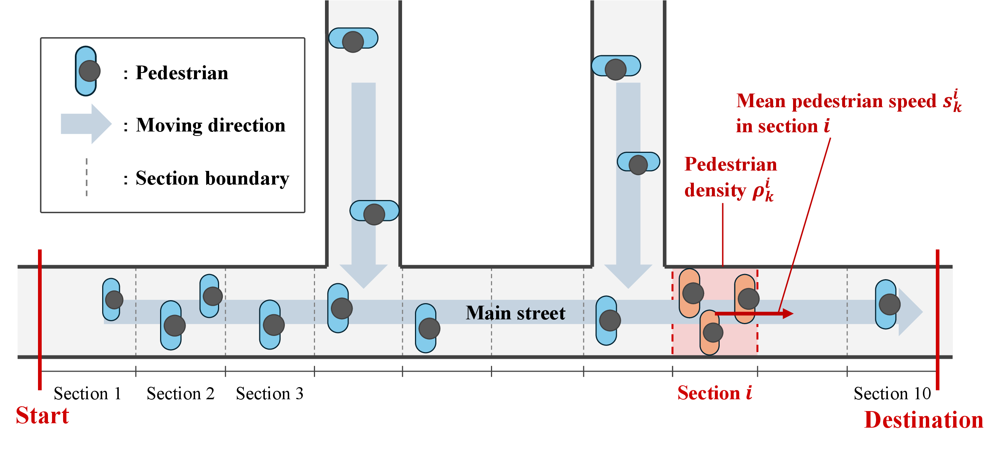

# Simulation Code for ECC: Crowd State Estimation Using Social Media Texts as Human Sensors

English | [日本語](README.ja.md)

## Crowd Flow Estimation Using Human-Generated Observations

This repository contains the code for our research on incorporating human-generated texts, such as "It's super crowded here" or "There's hardly anyone around", into state estimation as observations that can be treated on par with physical sensors.
The texts are fused with physical sensor measurements by a Kalman filter to estimate the pedestrian density and walking speed in each section of a corridor.

Each text is quantified by a BERT-based two-head network:

- **Classification head**: classifies the text into one of M categories and outputs the representative value of that category as the observation y. It also computes the variance σ²_cls, which reflects the low confidence of the classification (i.e., the ambiguity of interpretation).
- **Variance head**: estimates σ²_var, the residual component (e.g., quantization error) that does not appear in the classification confidence.

The key idea is to set R = σ²_cls + σ²_var dynamically for each observation as the observation noise variance of the Kalman filter.
The more ambiguous a text is, or the less related it is to the crowd state, the larger R becomes, so that its contribution to the estimate is automatically suppressed through the Kalman gain.

- σ²_cls is computed from the predicted class probabilities (`dist_var` in the code), and the variance head is trained to output a large variance for irrelevant texts.
- As a baseline, a **regression model** trained with the Gaussian negative log-likelihood (which directly outputs a value and a variance) is also implemented (`vsAI/`).

## Assumed Environment



We consider a main street divided into 10 sections, with pedestrians merging from two side streets along the way.
The pedestrian density ρ<sub>k</sub><sup>i</sup> and the mean walking speed s<sub>k</sub><sup>i</sup> of each section i at time step k are estimated as the state.

## Directory Structure

```
ECC/
├── README.md
├── README.ja.md                     Japanese version of this README
├── requirements.txt
├── common/                          Shared components for models and data processing
│   ├── models/encoder.py                BERT encoder (outputs the [CLS] embedding)
│   └── utils/
│       ├── dataset.py                   Label (5-class) conversion, Dataset / DataLoader
│       └── preprocess.py                Text preprocessing
│
├── docs/images/                     Images used in the README
│
├── data/                            Text data for training (in Japanese)
│   ├── train_den.json / val_den.json    Texts labeled with density
│   ├── train_vel.json / val_vel.json    Texts labeled with speed
│   └── split_data.py                    Script for splitting into train / val
│
├── training/                        Training of the text quantification models
│   ├── dual_head/                       Proposed: classification head + variance head
│   │   ├── models/                          Model definitions
│   │   ├── train.py / train_velocity.py     Training (density / speed)
│   │   ├── evaluate.py                      Evaluation on the validation data
│   │   └── predict.py                       Interactive prediction for a single text
│   └── gaussian_nll/                    Baseline: regression model with Gaussian NLL
│       ├── regression_model.py              Model definition
│       └── train_density.py / train_velocity.py
│
├── simulation/                      Simulation-based evaluation of the proposed method
│   ├── main.py                          Entry point of the experiments
│   ├── config.py                        Settings (number of sections, noise, sensor placement, etc.)
│   ├── model.py                         State-space model (A, B, Q)
│   ├── simulation.py                    Ground-truth generation and Kalman filter execution
│   ├── kalman.py                        One step of the Kalman filter
│   ├── sensors.py                       Observation generation for physical / human sensors
│   ├── nlp_bridge.py                    Text → observation value and observation variance R
│   ├── text_pool.json                   Texts posted in the simulation
│   ├── noisy_pool.json                  Texts unrelated to the crowd state
│   ├── csv/                             State transition matrix A
│   ├── experiments/                     Experiments (error rate / irrelevant-text rate / time series)
│   ├── plotting/                        Plotting
│   └── figure/                          Output figures and summary CSVs
│
└── vsAI/simulation_v2/              Comparison: classification + KF (proposed) vs. regression / regression + KF
    ├── main.py                          Entry point of the experiment
    ├── regression_bridge.py             Text → regression model output
    ├── estimators.py                    Estimation by the three methods
    ├── sensing.py                       Observation generation for human sensors
    ├── calibration.py                   Adjustment of the observation variance for regression
    ├── error_metrics.py                 RMSE / MAE
    ├── plots.py                         Plotting
    ├── paths.py                         Path settings
    └── results/                         Output figures
```

## Usage

### 1. Setup

```bash
git clone https://github.com/kumapanda073/ECC.git
cd ECC
pip install -r requirements.txt
```

<!-- TODO: Python version (e.g., Python 3.x) -->

The Japanese BERT model (`cl-tohoku/bert-base-japanese-v3`) is downloaded automatically from Hugging Face on the first run.

### 2. Training

The trained models (`.pt`, about 430 MB each) are not included in this repository due to their size, so please train them first.
Each script trains for 10 epochs and saves the model of every epoch in a folder next to the script.

```bash
# Proposed method (classification head + variance head)
python training/dual_head/train.py               # density → training/dual_head/checkpoints/
python training/dual_head/train_velocity.py      # speed   → training/dual_head/checkpoints_velocity/

# Baseline (regression model), used in the vsAI comparison
python training/gaussian_nll/train_density.py    # → training/gaussian_nll/checkpoints_regression_density/
python training/gaussian_nll/train_velocity.py   # → training/gaussian_nll/checkpoints_regression_velocity/
```

To check the trained models:

```bash
python training/dual_head/evaluate.py    # Evaluate accuracy, etc. on the validation data
python training/dual_head/predict.py     # Enter a text to see the estimated density and variance (q to quit)
```

### 3. Simulation (evaluation of the proposed method)

```bash
python simulation/main.py               # Run all experiments
python simulation/main.py error_rate    # Vary the text selection error rate
python simulation/main.py noise_rate    # Vary the ratio of irrelevant texts
python simulation/main.py timeseries    # Time-series estimation demo
python simulation/main.py replot        # Redraw figures from saved data only
```

Results are saved in `simulation/figure/`.
Conditions such as the number of sections, the number of trials, and the sensor placement can be changed in `simulation/config.py`.

### 4. Comparison: classification vs. regression

```bash
python vsAI/simulation_v2/main.py
```

Results are saved in `vsAI/simulation_v2/results/`.

## Paper

Currently under review.

## Author

Sakuma, Inoue Laboratory, Keio University
