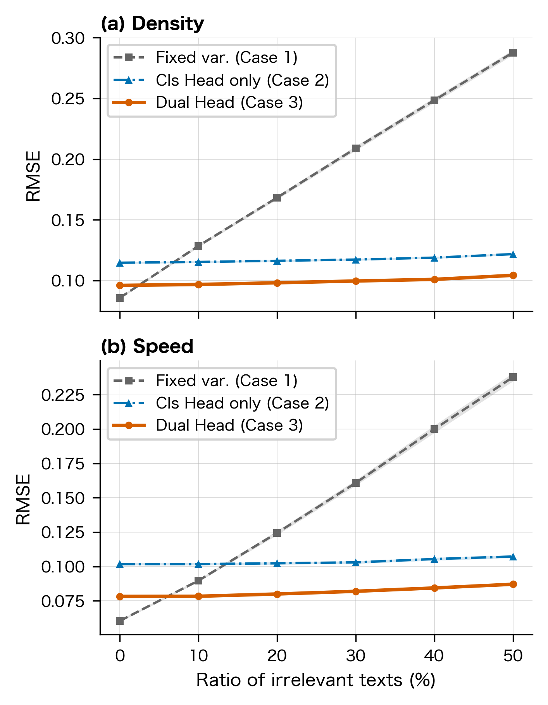

# ECC: SNS テキストを「人センサ」として用いた群集状態推定

<!-- TODO(本人): 正式な研究タイトル・所属・論文情報に置き換える -->

人が SNS に投稿する「混んでる」「全然進まない」といった短いテキストを **観測値付きのセンサ** とみなし、
カルマンフィルタで物理センサと融合して、通路の区間ごとの **群集密度・歩行速度** を推定する研究のコードです。

ポイントは、テキストから「値」だけでなく **その観測をどれだけ信用してよいか (分散)** も推定し、
カルマンフィルタの観測ノイズ R として使うことです。
無関係な投稿や曖昧な投稿は自動的に分散が大きくなり、推定への影響が小さくなります。

<!-- TODO(本人): 研究の背景・動機を 2〜3 行 (なぜ群集推定が必要か、なぜ SNS テキストか) -->

## 手法の概要

```
 真の群集状態 ──知覚ノイズ──▶ 人が投稿するテキスト
                                    │
                                    ▼
              BERT (cl-tohoku/bert-base-japanese-v3)
               ├─ 分類ヘッド : 密度 / 速度を 5 クラスに分類 → 観測値 (クラス中央値)
               └─ 分散ヘッド : テキストの信頼度          → 観測ノイズ R
                                    │
 物理センサ (一部区間のみ) ─────────┤
                                    ▼
           カルマンフィルタ (区間 10 × 密度・速度 = 20 次元の線形状態空間モデル)
                                    │
                                    ▼
                    区間ごとの密度・速度の推定値
```

- **観測分散 R** = 分類確率から計算した分散 (`dist_var`) + 分散ヘッドの出力。
  無関係なテキストには大きな分散を出すよう学習させている。
- 比較として、ガウス NLL で学習した **回帰モデル** (値と分散を直接出力) も実装している (`vsAI/`)。

## 主な結果

無関係なテキスト (ノイズ) が混ざる割合を変えたときの密度推定 RMSE
(100 試行平均、物理センサ 2 区間 + 全 10 区間に人センサ各 5 人。`simulation/figure/noise_rate/noise_rate_summary.csv`):

| 無関係テキストの割合 | 固定分散 | 分類確率の分散のみ | **提案手法** |
|---:|---:|---:|---:|
| 0 %  | 0.088 | 0.114 | **0.082** |
| 30 % | 0.214 | 0.117 | **0.091** |
| 50 % | 0.295 | 0.125 | **0.100** |

固定分散では無関係な投稿に引きずられて誤差が 3 倍以上に増えるのに対し、
提案手法はテキストごとの分散によって影響を抑え、誤差の増加を約 2 割にとどめている。



<!-- TODO(本人): 論文で一番見せたい図に差し替えてもよい -->

## ディレクトリ構成

```
ECC/
├── common/                共通部品
│   ├── models/encoder.py      BERT エンコーダ ([CLS] 埋め込み)
│   └── utils/                 ラベル変換・データセット・前処理
├── data/                  学習用テキストデータ (密度 / 速度ラベル付き)
├── training/
│   ├── dual_head/             分類ヘッド + 分散ヘッドのモデル (提案手法)
│   └── gaussian_nll/          ガウス NLL による回帰モデル (比較手法)
├── simulation/            シミュレーション評価 (提案手法)
│   ├── main.py                実験の入口
│   ├── config.py              区間数・ノイズ・センサ配置などの設定
│   ├── model.py               状態空間モデル (A, B, Q)
│   ├── sensors.py             物理センサ / 人センサの観測生成
│   ├── kalman.py              カルマンフィルタ 1 ステップ
│   ├── nlp_bridge.py          テキスト → 観測値・分散 (分類モデル)
│   ├── experiments/           誤り率 / ノイズ率 / 時系列の各実験
│   ├── plotting/              図の描画
│   └── figure/                出力した図と集計 CSV
└── vsAI/simulation_v2/    分類 + KF と 回帰 (+KF) の比較実験
```

## 実行方法

### 環境構築

```bash
pip install -r requirements.txt
```

<!-- TODO(本人): 使用した Python のバージョンを記入 (例: Python 3.x) -->

### 学習済みモデルについて

学習済みモデル (`.pt`, 1 個 約 430MB) はサイズの都合でリポジトリに含めていません。
以下で学習すると `training/*/checkpoints*/` に保存されます。

```bash
python -m training.dual_head.train            # 密度 (分類 + 分散ヘッド)
python -m training.dual_head.train_velocity   # 速度
python -m training.gaussian_nll.train_density # 回帰モデル (比較用)
python -m training.gaussian_nll.train_velocity
```

<!-- TODO(本人): 上の学習コマンドが実際に動くか確認 (ECC/ で実行する想定) -->

### シミュレーション

```bash
cd simulation
python main.py              # すべての実験
python main.py noise_rate   # 無関係テキストの割合を変える実験
python main.py error_rate   # テキスト選択ミス率を変える実験
python main.py timeseries   # 時系列デモ
python main.py replot       # 保存済みデータから図だけ再描画 (モデル不要)
```

分類 vs 回帰の比較実験:

```bash
python vsAI/simulation_v2/main.py
```

## 使用技術

Python / PyTorch / Hugging Face Transformers (日本語 BERT) / NumPy / pandas / Matplotlib

## 論文

<!-- TODO(本人): 論文情報 (タイトル・著者・発表先・年) と BibTeX -->

## 作者

<!-- TODO(本人): 名前・所属 (載せたい範囲で) -->
